# BareMetalJsTools

> A complete browser toolkit: reactive UI, CSS primitives, binary serialisation, schema validation, compression, transport, authentication, crypto, offline-first storage, routing, charts, workflows, structured logging, accessibility, media, forms, and more — all as plain dependency-free JavaScript.

Modern web development has become absurdly complicated. You need a bundler, a transpiler, a framework, a meta-framework, a state manager, a CSS-in-JS solution, and forty-seven config files before you can render "Hello World". Then you wait for it to compile.

**This toolkit takes a different approach: just host some damn files.**

BareMetalJsTools is a collection of tiny, zero-dependency vanilla-JS modules that give you reactive UI, REST transport, SPA routing, charts, and a full CSS framework — all as plain `<script>` tags. No build step. No compile phase. No node_modules black hole. Save your file, refresh your browser, and get on with your life.

Every module follows the same pattern: small, obvious, fast. You can read the source in one sitting. You can understand what it does without a tutorial series. And because there's nothing to build, your deploy is just... serving files. *How* you serve them matters — cache headers, compression, CDN — but the point is your toolchain stays out of your way.

> [Explore the interactive library showcase](https://willeastbury.github.io/BareMetalJsTools/)
> [Open the interactive sample applications](https://willeastbury.github.io/BareMetalJsTools/docs/apps/)
> [Browse the complete API and implementation library](https://willeastbury.github.io/BareMetalJsTools/docs/API-Library.html)

---

## What's in the box

| Module | What it does | Source | Min | Nearest equivalent for the not-quite-insane |
|---|---|---|---|---|
| [`BareMetal.Styles`](docs/BareMetal.Styles.md) | CSS framework. Grid, flex, buttons, forms, tables, cards, modals, alerts, toasts — all with short class names optimised for wire size. Zero JS. | [60.5 KB raw / 11.7 KB gzip](src/BareMetalStyles.css) | [45.1 KB raw / 9.0 KB gzip](src/BareMetalStyles.min.css) | *Bootstrap (227 KB)*, Tailwind (≈300 KB+), Fabric UI (≈350 KB), React (≈140 KB) |
| [`BareMetal.Styles.BootstrapCompatibilityShim`](src/BareMetal.Styles.BootstrapCompatibilityShim.css) | Drop-in Bootstrap 5 class-name compatibility. Use standard Bootstrap classes (`.btn`, `.card`, `.row`, `.col-md-6`, etc.) without loading Bootstrap itself. Optional — only needed if migrating from Bootstrap. | [29.1 KB raw / 5.4 KB gzip](src/BareMetal.Styles.BootstrapCompatibilityShim.css) | [24.3 KB raw / 4.8 KB gzip](src/BareMetal.Styles.BootstrapCompatibilityShim.min.css) | *Bootstrap 5 (227 KB)* — this replaces it at 1/9th the size |
| Themes | Swap the colour palette with a single `<link>`. ~800 bytes source, ~600 bytes min each. | | | *Bootswatch (≈8 KB per theme)* |

**Available themes** (`src/themes/`):

| Theme | Vibe | File |
|-------|------|------|
| `base` | Clean white, soft greys, gentle blue | [base.css](src/themes/base.css) |
| `bedlam` | Dark cyberpunk — neon purples & teals | [bedlam.css](src/themes/bedlam.css) |
| `wavefunction` | Dark scientific — deep slate & electric indigo | [wavefunction.css](src/themes/wavefunction.css) |
| `lava` | Fiery dark — molten oranges on volcanic black | [lava.css](src/themes/lava.css) |
| `candy` | Soft candy pink — pastels & lilacs on warm white | [candy.css](src/themes/candy.css) |

```html
<!-- Load core + optional theme (after core, overrides :root vars) -->
<link href="BareMetalStyles.min.css" rel="stylesheet">
<link href="themes/bedlam.min.css" rel="stylesheet">
```

**Bundled fonts** (`src/fonts/`) — load [`fonts.css`](src/fonts/fonts.css) for `@font-face` declarations:

| Font | Type | Size | Use case |
|------|------|------|----------|
| `BareMetalMono` | JetBrains Mono subset | 17 KB | Code, data, terminals |
| `BareMetalSans` | Inter subset | 14 KB | Clean body text, UI |
| `BareMetalPixel` | Silkscreen subset | 2.7 KB | Retro, IoT, tiny displays |
| `Wavefunction-Sans` | Source Sans 3 subset | 27 KB | Versatile modern sans-serif |
| `Wavefunction-Curly` | Dancing Script subset | 28 KB | Flowing handwriting/calligraphy |
| `Wavefunction-Serif` | Source Serif 4 subset | 28 KB | Professional typeset (Times-like) |

```html
<!-- Load fonts (optional — themes reference them via --bs-font-sans) -->
<link href="fonts/fonts.min.css" rel="stylesheet">
<link href="BareMetalStyles.min.css" rel="stylesheet">
<link href="themes/wavefunction.min.css" rel="stylesheet">
```

| Module | What it does | Source | Min | Nearest equivalent for the not-quite-insane |
|---|---|---|---|---|
| [`BareMetal.Bind`](docs/BareMetal.Bind.md) | Reactive `Proxy` state + two-way native controls, keyed lists, timed expressions, manual refresh, add/remove rows and many-to-many bindings. | [32.3 KB raw / 7.3 KB gzip](src/BareMetal.Bind.js) | [22.3 KB raw / 5.9 KB gzip](src/BareMetal.Bind.min.js) | Vue.js (≈40 KB min), Alpine.js (≈15 KB), Rivets.js ❤️, *Knockout.js ❤️*, TinyBind 💕 |
| [`BareMetal.Components`](docs/BareMetal.Components.md) | Widget directives including fast dotted-field tables, nested tables and many-valued relation cells. | [28.3 KB raw / 7.0 KB gzip](src/BareMetal.Components.js) | [19.3 KB raw / 6.0 KB gzip](src/BareMetal.Components.min.js) | PrimeVue, Vuetify, Material UI (hundreds of KB each) |
| [`BareMetal.ComponentFactories`](docs/BareMetal.ComponentFactories.md) | `create.*` helpers and `chatEndpoint()` auto-wire for REST-backed chatbots. | [2.6 KB raw / 1.0 KB gzip](src/BareMetal.ComponentFactories.js) | [1.5 KB raw / 0.7 KB gzip](src/BareMetal.ComponentFactories.min.js) | *Hand-rolled boilerplate* |
| [`BareMetal.Template`](docs/BareMetal.Template.md) | Schema-driven DOM builder for forms, flat tables, nested tables and many-relations. | [9.9 KB raw / 3.2 KB gzip](src/BareMetal.Template.js) | [7.2 KB raw / 2.7 KB gzip](src/BareMetal.Template.min.js) | Formly (≈80 KB), *JSON Forms (≈200 KB)* |
| [`BareMetal.Chat`](docs/BareMetal.Chat.md) | Theme-aware sidebar, conversation list, transcript, composer, status, and response-control layout primitives. | [4.1 KB raw / 1.1 KB gzip](src/BareMetal.Chat.css) | — | App-local chat page styling |
| [`BareMetal.Controls`](docs/BareMetal.Controls.md) | Shared accessible range, disclosure, and help controls. | [2.6 KB raw / 0.9 KB gzip](src/BareMetal.Controls.js) | [4.1 KB raw / 1.3 KB gzip](src/BareMetal.Controls.css) | No equivalent |
| [`BareMetal.Modal`](docs/BareMetal.Modal.md) | Native dialog wrapper with focus restoration and busy state. | [2.0 KB raw / 0.9 KB gzip](src/BareMetal.Modal.js) | [0.5 KB raw / 0.3 KB gzip](src/BareMetal.Modal.css) | Bootstrap modal JS |
| [`BareMetal.Gallery`](docs/BareMetal.Gallery.md) | Responsive media catalogue with filters, favourites, sorting, list/grid views, and preview. | [10.3 KB raw / 3.5 KB gzip](src/BareMetal.Gallery.js) | [4.2 KB raw / 1.3 KB gzip](src/BareMetal.Gallery.css) | Media gallery libraries |
| [`BareMetal.Metadata`](docs/BareMetal.Metadata.md) | Client-side entity schema registry. Inline JSON or server fetch — declare your entities and render them automatically. | [9.3 KB raw / 2.7 KB gzip](src/BareMetal.Metadata.js) | [4.6 KB raw / 1.8 KB gzip](src/BareMetal.Metadata.min.js) | *GraphQL schema* + codegen toolchain |
| [`BareMetal.Communications`](docs/BareMetal.Communications.md) | REST + WebSocket transport. Negotiates WS binary frames → BSO1 → JSON fallback. CSRF, 401-redirect, request multiplexing. | [19.8 KB raw / 5.2 KB gzip](src/BareMetal.Communications.js) | [12.3 KB raw / 3.6 KB gzip](src/BareMetal.Communications.min.js) | Axios (≈14 KB) + *socket.io-client* (≈45 KB) |
| [`BareMetal.Launcher`](docs/BareMetal.Launcher.md) | Hosted terminal/session launcher helpers. API wrapper, tiny store, session cards, idle display, reconnecting WebSocket attach, optional xterm bridge. | [14.6 KB raw / 4.0 KB gzip](src/BareMetal.Launcher.js) | [7.4 KB raw / 2.9 KB gzip](src/BareMetal.Launcher.min.js) | *React shell* + socket.io-client + state library |
| [`BareMetal.Binary`](docs/BareMetal.Binary.md) | BSO1 binary wire serialiser. Zero-copy `DataView` reads, HMAC-SHA256 signing via Web Crypto. | [22.6 KB raw / 5.8 KB gzip](src/BareMetal.Binary.js) | [14.0 KB raw / 4.4 KB gzip](src/BareMetal.Binary.min.js) | Protocol Buffers JS (≈230 KB), *MessagePack (≈25 KB)* |
| [`BareMetal.Compress`](docs/BareMetal.Compress.md) | Block-based LZ compressor for byte-efficient wire and storage formats. Opt-in wire compression for Communications. | [19.7 KB raw / 4.7 KB gzip](src/BareMetal.Compress.js) | [8.3 KB raw / 3.1 KB gzip](src/BareMetal.Compress.min.js) | Brotli.js (≈300 KB), *HeatShrink (≈8 KB)* |
| [`BareMetal.Rendering`](docs/BareMetal.Rendering.md) | Glue layer — wires Rest + Bind + Template into an entity lifecycle (`createEntity`, `listEntities`). | [4.6 KB raw / 1.6 KB gzip](src/BareMetal.Rendering.js) | [1.9 KB raw / 0.9 KB gzip](src/BareMetal.Rendering.min.js) | *Custom Redux middleware* + React container layer |
| [`BareMetal.Routing`](docs/BareMetal.Routing.md) | History-API SPA router. Named segments (`:param`), catch-all (`*`), query parsing. | [9.9 KB raw / 3.0 KB gzip](src/BareMetal.Routing.js) | [3.4 KB raw / 1.3 KB gzip](src/BareMetal.Routing.min.js) | *vue-router (≈18 KB)*, react-router (≈30 KB) |
| [`BareMetal.Charts`](docs/BareMetal.Charts.md) | SVG charts — bar, line, sparkline, donut, gauge. Animated, themeable via CSS custom properties. | [16.4 KB raw / 4.2 KB gzip](src/BareMetal.Charts.js) | [8.5 KB raw / 3.0 KB gzip](src/BareMetal.Charts.min.js) | *Chart.js (≈200 KB)*, D3 (≈250 KB) |
| [`BareMetal.Pivot`](docs/BareMetal.Pivot.md) | Group, summarise, sort, and filter records. Optional bar chart. | [7.7 KB raw / 2.6 KB gzip](src/BareMetal.Pivot.js) | [4.7 KB raw / 2.0 KB gzip](src/BareMetal.Pivot.min.js) | Pivot tables, Crosstab |
| [`BareMetal.Graph`](docs/BareMetal.Graph.md) | Force-directed graph visualiser. Drag, zoom, hover, dynamic add/remove. | [18.5 KB raw / 4.7 KB gzip](src/BareMetal.Graph.js) | [9.6 KB raw / 3.4 KB gzip](src/BareMetal.Graph.min.js) | D3-force (≈30 KB) + D3-selection (≈20 KB), *Cytoscape.js* (≈600 KB) |
| [`BareMetal.3DXR`](docs/BareMetal.3DXR.md) | Dependency-free WebGL/WebXR video tiles, gaze-to-audio focus, playlists, and ambient audio. | [37.0 KB raw / 8.6 KB gzip](src/BareMetal.3DXR.js) | — | Three.js + video/audio plumbing |
| [`BareMetal.MusicPlayer`](docs/BareMetal.MusicPlayer.md) | Browser music playlists, remote-callable controls, repeat/shuffle, Media Session, and crossfades. | [15.3 KB raw / 3.6 KB gzip](src/BareMetal.MusicPlayer.js) | [11.7 KB raw / 3.2 KB gzip](src/BareMetal.MusicPlayer.min.js) | Howler.js, Plyr |
| [`BareMetal.ID3`](docs/BareMetal.ID3.md) | Dependency-free ID3v1/ID3v2 metadata reader for MP3 ArrayBuffer, Blob and File inputs. | [6.4 KB raw / 1.9 KB gzip](src/BareMetal.ID3.js) | [4.6 KB raw / 1.6 KB gzip](src/BareMetal.ID3.min.js) | music-metadata, jsmediatags |
| [`BareMetal.MP3`](docs/BareMetal.MP3.md) | Native MP3 streaming, ID3 convenience API and player integration. | [1.4 KB raw / 0.5 KB gzip](src/BareMetal.MP3.js) | [1.0 KB raw / 0.4 KB gzip](src/BareMetal.MP3.min.js) | Plyr, Howler.js |
| [`BareMetal.MP3Catalog`](docs/BareMetal.MP3Catalog.md) | Generate, load, index and search MP3 manifest catalogs with tag-content fields. | [6.2 KB raw / 1.8 KB gzip](src/BareMetal.MP3Catalog.js) | [4.6 KB raw / 1.6 KB gzip](src/BareMetal.MP3Catalog.min.js) | Custom catalog index |
| [`BareMetal.MIDI`](docs/BareMetal.MIDI.md) | Web MIDI access with note, CC and pitch-bend routing. | [3.3 KB raw / 1.1 KB gzip](src/BareMetal.MIDI.js) | [2.4 KB raw / 0.9 KB gzip](src/BareMetal.MIDI.min.js) | WebMidi.js |
| [`BareMetal.DJMixer`](docs/BareMetal.DJMixer.md) | Four-channel Web Audio mixer with EQ, gain, pan, pitch, meters and crossfader. | [16.5 KB raw / 3.6 KB gzip](src/BareMetal.DJMixer.js) | [12.1 KB raw / 3.2 KB gzip](src/BareMetal.DJMixer.min.js) | Custom DJ mixer |
| [`BareMetal.DJDeck`](docs/BareMetal.DJDeck.md) | Two-deck browser playback primitive with cues, loops, pitch, BPM and waveforms. | [10.2 KB raw / 3.0 KB gzip](src/BareMetal.DJDeck.js) | [7.3 KB raw / 2.7 KB gzip](src/BareMetal.DJDeck.min.js) | Custom DJ deck engine |
| [`BareMetal.DJLibrary`](docs/BareMetal.DJLibrary.md) | IndexedDB track, cue, loop, playlist and settings library. | [5.6 KB raw / 1.4 KB gzip](src/BareMetal.DJLibrary.js) | [4.3 KB raw / 1.2 KB gzip](src/BareMetal.DJLibrary.min.js) | Music library databases |
| [`BareMetal.MIDIProfiles`](docs/BareMetal.MIDIProfiles.md) | Import/export and MIDI-learn controller profiles, including an unverified OMNIS-DUO placeholder. | [4.0 KB raw / 1.2 KB gzip](src/BareMetal.MIDIProfiles.js) | [3.0 KB raw / 1.0 KB gzip](src/BareMetal.MIDIProfiles.min.js) | Controller profile editors |
| [`BareMetal.VTTerminal`](docs/BareMetal.VTTerminal.md) | Scrollback ANSI/VT terminal driver for WebSockets and web workers. | [12.7 KB raw / 3.3 KB gzip](src/BareMetal.VTTerminal.js) | [8.7 KB raw / 2.9 KB gzip](src/BareMetal.VTTerminal.min.js) | xterm.js |
| [`BareMetal.Auth`](docs/BareMetal.Auth.md) | OIDC/OAuth2 PKCE client. Silent refresh, provider presets (Google, Microsoft, GitHub, Apple, Facebook), login/whoami UI components. | [28.8 KB raw / 8.0 KB gzip](src/BareMetal.Auth.js) | [16.0 KB raw / 6.0 KB gzip](src/BareMetal.Auth.min.js) | *oidc-client-ts (≈80 KB)*, Auth0 SPA SDK (≈60 KB) |
| [`BareMetal.Crypto`](docs/BareMetal.Crypto.md) | Web Crypto wrapper. AES-256-GCM symmetric, RSA-OAEP hybrid envelope, ECDSA P-256 signing, PBKDF2 key derivation. | [5.3 KB raw / 1.6 KB gzip](src/BareMetal.Crypto.js) | [2.8 KB raw / 1.1 KB gzip](src/BareMetal.Crypto.min.js) | *Stanford JS Crypto (≈45 KB)*, tweetnacl (≈7 KB) |
| [`BareMetal.LocalKVStore`](docs/BareMetal.LocalKVStore.md) | Key-value store abstraction. localStorage, sessionStorage, IndexedDB backends with TTL, namespacing, cross-tab sync. | [14.1 KB raw / 2.9 KB gzip](src/BareMetal.LocalKVStore.js) | [6.9 KB raw / 2.0 KB gzip](src/BareMetal.LocalKVStore.min.js) | *localForage (≈29 KB)*, idb-keyval (≈1 KB) |
| [`BareMetal.Progressive`](docs/BareMetal.Progressive.md) | PWA helper. Service worker registration, install prompts, offline request queue, push notifications, manifest generation. | [10.9 KB raw / 2.9 KB gzip](src/BareMetal.Progressive.js) | [5.7 KB raw / 2.0 KB gzip](src/BareMetal.Progressive.min.js) | *Workbox (≈60 KB)*, PWA Builder |
| [`BareMetal.ServiceWorker`](docs/BareMetal.ServiceWorker.md) | Configurable service worker. CacheFirst, NetworkFirst, StaleWhileRevalidate strategies, precache, background sync. | [7.6 KB raw / 2.0 KB gzip](src/BareMetal.ServiceWorker.js) | [4.1 KB raw / 1.5 KB gzip](src/BareMetal.ServiceWorker.min.js) | *Workbox SW (≈15 KB)* |
| [`BareMetal.Time`](docs/BareMetal.Time.md) | Date/time library. Format, parse, add/subtract, diff, durations, relative time, timezone support, Temporal API bridge. | [11.7 KB raw / 3.1 KB gzip](src/BareMetal.Time.js) | [6.9 KB raw / 2.3 KB gzip](src/BareMetal.Time.min.js) | *Day.js (≈7 KB)*, date-fns (≈75 KB), Moment.js (≈290 KB) |
| [`BareMetal.Validate`](docs/BareMetal.Validate.md) | Schema validation. Required, type, min/max, pattern, nested objects, arrays, custom rules, error objects with path+code+message. | [4.1 KB raw / 1.3 KB gzip](src/BareMetal.Validate.js) | [2.6 KB raw / 1.1 KB gzip](src/BareMetal.Validate.min.js) | *Yup (≈40 KB)*, Joi (≈150 KB), Zod (≈14 KB) |
| [`BareMetal.I18n`](docs/BareMetal.I18n.md) | Internationalisation. Locale fallback chains, ICU plural rules via `Intl.PluralRules`, interpolation, number/date formatting. | [5.1 KB raw / 1.7 KB gzip](src/BareMetal.I18n.js) | [2.5 KB raw / 1.1 KB gzip](src/BareMetal.I18n.min.js) | *i18next (≈40 KB)*, FormatJS (≈30 KB) |
| [`BareMetal.StateMachine`](docs/BareMetal.StateMachine.md) | Finite state machine. States, transitions, guards, actions, context, subscribe/unsubscribe. | [3.0 KB raw / 1.0 KB gzip](src/BareMetal.StateMachine.js) | [1.4 KB raw / 0.6 KB gzip](src/BareMetal.StateMachine.min.js) | *XState (≈50 KB)*, Robot (≈4 KB) |
| [`BareMetal.Logger`](docs/BareMetal.Logger.md) | Structured logging. Levels, transports (console, beacon, custom), batching, safe circular-ref stringify, child loggers. | [4.8 KB raw / 1.6 KB gzip](src/BareMetal.Logger.js) | [2.5 KB raw / 1.1 KB gzip](src/BareMetal.Logger.min.js) | *Winston (≈80 KB)*, Pino (≈30 KB), loglevel (≈3 KB) |
| [`BareMetal.Animate`](docs/BareMetal.Animate.md) | CSS transition/animation helper. Enter/leave, stagger, spring, respects `prefers-reduced-motion`, timeout fallback. | [8.0 KB raw / 2.2 KB gzip](src/BareMetal.Animate.js) | [3.6 KB raw / 1.5 KB gzip](src/BareMetal.Animate.min.js) | *Framer Motion (≈120 KB)*, GSAP (≈60 KB), animate.css (≈80 KB) |
| [`BareMetal.TestRunner`](docs/BareMetal.TestRunner.md) | Dependency-free in-browser test runner. describe/it/expect, async, hooks, mocks, grep, bail, retry, TAP + Markdown reporters. | [29.7 KB raw / 6.9 KB gzip](src/BareMetal.TestRunner.js) | [19.9 KB raw / 5.7 KB gzip](src/BareMetal.TestRunner.min.js) | Mocha (≈100 KB), uvu (≈6 KB), Jest (≈1 MB) |
| [`BareMetal.Minifier`](docs/MINIFY.md) | Dependency-free JavaScript/CSS lexical minifier with Edge/CDP build tooling. | [15.2 KB raw / 3.4 KB gzip](src/BareMetal.Minifier.js) | — | Terser, clean-css |
| [`BareMetal.Integrity`](docs/BareMetal.Integrity.md) | SHA-256 module manifests and fail-closed source verification. | [5.2 KB raw / 1.7 KB gzip](src/BareMetal.Integrity.js) | — | SRI, signed release manifests |
| [`BareMetal.ModuleLoader`](docs/BareMetal.ModuleLoader.md) | Verified, cached, optionally compressed browser module loading. | [5.3 KB raw / 1.7 KB gzip](src/BareMetal.ModuleLoader.js) | — | SystemJS, import maps |
| [`BareMetal.SecureTransport`](docs/BareMetal.SecureTransport.md) | RSA-OAEP + AES-GCM application payload envelopes beyond TLS. | [8.2 KB raw / 2.3 KB gzip](src/BareMetal.SecureTransport.js) | — | Custom end-to-end crypto |
| [`BareMetal.DragDrop`](docs/BareMetal.DragDrop.md) | Pointer-event drag & drop. Sortable lists, drop zones, constraints, touch support, `setPointerCapture`. | [11.4 KB raw / 3.0 KB gzip](src/BareMetal.DragDrop.js) | [6.3 KB raw / 2.2 KB gzip](src/BareMetal.DragDrop.min.js) | *SortableJS (≈40 KB)*, dnd-kit (≈45 KB), Draggable (≈80 KB) |
| [`BareMetal.A11y`](docs/BareMetal.A11y.md) | Accessibility helpers. Focus traps, live regions, skip links, roving tabindex, keyboard navigation, ARIA attribute management. | [9.3 KB raw / 2.5 KB gzip](src/BareMetal.A11y.js) | [4.8 KB raw / 1.7 KB gzip](src/BareMetal.A11y.min.js) | *focus-trap (≈10 KB)*, ally.js (≈130 KB) |
| [`BareMetal.Expressions`](docs/BareMetal.Expressions.md) | 50+ pre-built regex patterns. Email, phone, URL, postal codes, credit card, UUID, semver, JWT, dates, and more. `test()`, `extract()`, `detect()`, `register()`. | [24.2 KB raw / 6.5 KB gzip](src/BareMetal.Expressions.js) | [16.5 KB raw / 5.8 KB gzip](src/BareMetal.Expressions.min.js) | *validator.js (≈60 KB)*, regex collections scattered across Stack Overflow |
| [`BareMetal.Tokens`](docs/BareMetal.Tokens.md) | JWT library. Create, sign (HS256/384/512, RS256, ES256), verify, decode, inspect. Fluent builder, PEM/JWK import, key generation via Web Crypto. | [19.1 KB raw / 4.4 KB gzip](src/BareMetal.Tokens.js) | [9.6 KB raw / 3.3 KB gzip](src/BareMetal.Tokens.min.js) | *jsonwebtoken (≈30 KB + deps)*, jose (≈100 KB) |
| [`BareMetal.Codes`](docs/BareMetal.Codes.md) | Reference data. Countries (250), currencies, languages, timezones, HTTP status codes, MIME types, CSS colours, card types, units. Lazy-parsed compact encoding. | [29.4 KB raw / 14.2 KB gzip](src/BareMetal.Codes.js) | [28.8 KB raw / 14.1 KB gzip](src/BareMetal.Codes.min.js) | *country-data (≈200 KB)*, i18n-iso-countries (≈100 KB), scattered npm packages |
| [`BareMetal.RBAC`](docs/BareMetal.RBAC.md) | Client-side role/permission UI hints. Reads JWT from storage/cookie, checks roles, groups, permissions, scopes. DOM attribute processing. **UI hints only — enforce server-side.** | [18.7 KB raw / 4.5 KB gzip](src/BareMetal.RBAC.js) | [8.9 KB raw / 3.2 KB gzip](src/BareMetal.RBAC.min.js) | *CASL (≈30 KB)*, casbin.js (≈50 KB), custom middleware |
| [`BareMetal.Workflow`](docs/BareMetal.Workflow.md) | Minimal workflow engine. SET/IF/ELSE/FOR/FOREACH/FOREACHP/WEB/LOAD/SAVE/LOG/WAIT/CALL. Registry, JSON serialization, visual designer component. | [62.3 KB raw / 15.5 KB gzip](src/BareMetal.Workflow.js) | [36.4 KB raw / 11.3 KB gzip](src/BareMetal.Workflow.min.js) | *n8n (massive)*, Camunda (enterprise), custom state machines |
| [`BareMetal.Markdown`](docs/BareMetal.Markdown.md) | GFM Markdown-to-HTML renderer. Headings, lists, tables, code blocks, inline formatting, TOC, front matter, custom renderers, sanitize mode. | [17.7 KB raw / 5.0 KB gzip](src/BareMetal.Markdown.js) | [10.6 KB raw / 4.0 KB gzip](src/BareMetal.Markdown.min.js) | *marked.js (≈39 KB)*, markdown-it (≈100 KB), showdown (≈70 KB) |
| [`BareMetal.Play`](docs/BareMetal.Play.md) | Interactive story reader over JSON packs. Gated choices, effects, persona-filled Markdown, in-page letters and notes. | [27.2 KB raw / 6.5 KB gzip](src/BareMetal.Play.js) | [13.9 KB raw / 4.6 KB gzip](src/BareMetal.Play.min.js) | Twine (huge), custom CYOA shells |
| [`BareMetal.Story`](docs/BareMetal.Story.md) | Story authoring editor. Interactions, options, personas, templates, and a graph map over the same packs. | [46.2 KB raw / 10.4 KB gzip](src/BareMetal.Story.js) | [26.0 KB raw / 8.0 KB gzip](src/BareMetal.Story.min.js) | Twine, custom CMS |
| [`BareMetal.Sheet`](docs/BareMetal.Sheet.md) | Spreadsheet cell view. A1 grid, formula bar, selection, in-cell edit, per-cell style. | [17.7 KB raw / 4.5 KB gzip](src/BareMetal.Sheet.js) | [9.3 KB raw / 3.5 KB gzip](src/BareMetal.Sheet.min.js) | Handsontable, Luckysheet |
| [`BareMetal.Document`](docs/BareMetal.Document.md) | Semantic HTML editor (not RTF). Headings, lists, colour, font. | [4.0 KB raw / 1.5 KB gzip](src/BareMetal.Document.js) | [2.6 KB raw / 1.2 KB gzip](src/BareMetal.Document.min.js) | contenteditable, Quill, Tiptap |
| [`BareMetal.DocumentRenderer`](docs/BareMetal.DocumentRenderer.md) | Dependency-free HTML-to-PDF: browser layout, rasterized pages, and searchable text layer. Writes real PDF bytes in JavaScript; no print pipeline. | [27.2 KB raw / 8.1 KB gzip](src/BareMetal.DocumentRenderer.js) | [21.2 KB raw / 7.4 KB gzip](src/BareMetal.DocumentRenderer.min.js) | *pdfmake*, jsPDF, browser print-to-PDF |
| [`BareMetal.Ribbon`](docs/BareMetal.Ribbon.md) | Compact command bar — a ribbon alternative with groups, toggles, colour and font slots. | [5.3 KB raw / 1.7 KB gzip](src/BareMetal.Ribbon.js) | [3.2 KB raw / 1.3 KB gzip](src/BareMetal.Ribbon.min.js) | Office ribbon, custom toolbars |
| [`BareMetal.FooterBar`](docs/BareMetal.FooterBar.md) | Footer strip: status, sheet tabs, zoom. | [4.1 KB raw / 1.4 KB gzip](src/BareMetal.FooterBar.js) | [2.5 KB raw / 1.1 KB gzip](src/BareMetal.FooterBar.min.js) | Spreadsheet status bar |
| [`BareMetal.Colour`](docs/BareMetal.Colour.md) | Swatch + hex colour picker. | [5.0 KB raw / 1.8 KB gzip](src/BareMetal.Colour.js) | [3.3 KB raw / 1.5 KB gzip](src/BareMetal.Colour.min.js) | `<input type=color>` |
| [`BareMetal.Font`](docs/BareMetal.Font.md) | Font family and size picker with live preview. | [4.5 KB raw / 1.6 KB gzip](src/BareMetal.Font.js) | [2.9 KB raw / 1.3 KB gzip](src/BareMetal.Font.min.js) | OS font dialogs |
| [`BareMetal.DocumentWAL`](docs/BareMetal.DocumentWAL.md) | Change log, merge, compact snapshot, undo/redo, and downloadable operation streams. | [8.8 KB raw / 2.4 KB gzip](src/BareMetal.DocumentWAL.js) | [4.4 KB raw / 1.7 KB gzip](src/BareMetal.DocumentWAL.min.js) | Yjs, Automerge, OT |
| [`BareMetal.MermaidDiagramRenderer`](docs/BareMetal.MermaidDiagramRenderer.md) | Safe, dependency-free SVG rendering for a documented Mermaid flowchart and sequence diagram subset. | [10.4 KB raw / 3.4 KB gzip](src/BareMetal.MermaidDiagramRenderer.js) · [0.7 KB raw / 0.3 KB gzip](src/BareMetal.MermaidDiagramRenderer.css) | | mermaid.js (≈2 MB) |
| [`BareMetal.PicoScript`](docs/BareMetal.PicoScript.md) | Real PicoScript 16-opcode ISA: 4-frontend compiler (C/BASIC/Python/English) + deterministic VM + 456 host hooks across 63 namespaces (OS-worker, AI, storage, crypto, UI, capsules). Runs the same bytecode as PIOS bare metal. | [493.8 KB raw / 112.5 KB gzip](src/BareMetal.PicoScript.js) | — | *No equivalent* — complete language VM + compiler in one file |
| [`BareMetal.WorkflowPico`](docs/BareMetal.WorkflowPico.md) | Compiles `BareMetal.Workflow` step lists to PicoScript (English dialect) — the visual workflow designer becomes a PicoScript frontend that runs on the browser/RP2350/PIOS/C# VM. Adds a "Compile to PicoScript" designer button. | [33.1 KB raw / 8.9 KB gzip](src/BareMetal.WorkflowPico.js) | [15.2 KB raw / 5.5 KB gzip](src/BareMetal.WorkflowPico.min.js) | *No equivalent* — visual workflow → deterministic bytecode |
| [`BareMetal.Report`](docs/BareMetal.Report.md) | Report & form builder. One templated layout engine, two modes: report (read-only table + aggregate footer) and form (read-write inputs + write-back). Visual designer to create/edit templates. Byte-aligned with PicoScript's picolayout. | [23.8 KB raw / 6.1 KB gzip](src/BareMetal.Report.js) | [12.9 KB raw / 4.1 KB gzip](src/BareMetal.Report.min.js) | *JasperReports (huge)*, hand-rolled table/form code |
| [`BareMetal.Clipboard`](docs/BareMetal.Clipboard.md) | Clipboard API wrapper. Read/write text/HTML/images, paste intercept, copy-with-feedback, legacy execCommand fallback. | [7.6 KB raw / 2.6 KB gzip](src/BareMetal.Clipboard.js) | [6.5 KB raw / 2.4 KB gzip](src/BareMetal.Clipboard.min.js) | *clipboard.js (≈7 KB)* |
| [`BareMetal.Speech`](docs/BareMetal.Speech.md) | Web Speech API wrapper. Speech synthesis, recognition sessions, voice commands, dictation, queued utterances. | [7.3 KB raw / 2.4 KB gzip](src/BareMetal.Speech.js) | [5.7 KB raw / 2.1 KB gzip](src/BareMetal.Speech.min.js) | *react-speech-recognition (≈30 KB)*, *annyang (≈13 KB)* |
| [`BareMetal.FileIO`](docs/BareMetal.FileIO.md) | File System Access API + fallbacks. Open/save picker, drag-drop zones, chunked reading, download, format utilities. | [12.2 KB raw / 3.9 KB gzip](src/BareMetal.FileIO.js) | [8.5 KB raw / 3.1 KB gzip](src/BareMetal.FileIO.min.js) | *FileSaver.js (≈5 KB)* + *Dropzone (≈95 KB)* |
| [`BareMetal.Notify`](docs/BareMetal.Notify.md) | Toast/banner queue + Notification API. info/success/warning/error types, progress bars, stacking, auto-dismiss, dark/light themes. | [10.8 KB raw / 3.9 KB gzip](src/BareMetal.Notify.js) | [10.7 KB raw / 3.8 KB gzip](src/BareMetal.Notify.min.js) | *Toastr (≈8 KB)*, notyf (≈15 KB), react-hot-toast (≈30 KB) |
| [`BareMetal.PubSub`](docs/BareMetal.PubSub.md) | Event bus. Wildcard topics (*/\*\*), namespaces, sticky/replay, typed channels, request/response, middleware. | [9.4 KB raw / 2.3 KB gzip](src/BareMetal.PubSub.js) | [3.9 KB raw / 1.6 KB gzip](src/BareMetal.PubSub.min.js) | *EventEmitter3 (≈3 KB)*, mitt (≈1 KB), postal.js (≈20 KB) |
| [`BareMetal.UndoRedo`](docs/BareMetal.UndoRedo.md) | Command pattern undo/redo. Grouping, snapshots, checkpoints, serialization, keyboard binding, event hooks. | [6.2 KB raw / 1.9 KB gzip](src/BareMetal.UndoRedo.js) | [4.5 KB raw / 1.7 KB gzip](src/BareMetal.UndoRedo.min.js) | *Custom implementations* — no dominant library |
| [`BareMetal.IDB`](docs/BareMetal.IDB.md) | Promise-based IndexedDB. CRUD, indexes, range queries, cursors, transactions, batch ops, KV mode, export/import. | [11.6 KB raw / 2.9 KB gzip](src/BareMetal.IDB.js) | [6.9 KB raw / 2.1 KB gzip](src/BareMetal.IDB.min.js) | *idb (≈5 KB)*, Dexie (≈80 KB), localForage (≈30 KB) |
| [`BareMetal.Workers`](docs/BareMetal.Workers.md) | Inline WebWorker pool + scheduler. debounce/throttle, RAF read/write batching, idle queue, priority task queue, retry/timeout. | [9.0 KB raw / 3.1 KB gzip](src/BareMetal.Workers.js) | [8.9 KB raw / 3.1 KB gzip](src/BareMetal.Workers.min.js) | *workerpool (≈20 KB)*, comlink (≈5 KB), lodash.debounce (≈1 KB) |
| [`BareMetal.Geo`](docs/BareMetal.Geo.md) | Geolocation, Haversine distance, bearing, geohash encode/decode, point-in-polygon, bounding box, tracking, geocoding. | [8.5 KB raw / 3.2 KB gzip](src/BareMetal.Geo.js) | [6.1 KB raw / 2.6 KB gzip](src/BareMetal.Geo.min.js) | *geolib (≈30 KB)*, Leaflet (≈170 KB) |
| [`BareMetal.Media`](docs/BareMetal.Media.md) | Camera, microphone, screen capture, MediaRecorder, snapshot, PiP, device enumeration, audio analyser. | [10.2 KB raw / 3.3 KB gzip](src/BareMetal.Media.js) | [7.8 KB raw / 2.8 KB gzip](src/BareMetal.Media.min.js) | *RecordRTC (≈120 KB)*, custom implementations |
| [`BareMetal.Pay`](docs/BareMetal.Pay.md) | Payment Request API, cart management, Luhn card validation, currency formatting, shipping options. | [11.0 KB raw / 3.4 KB gzip](src/BareMetal.Pay.js) | [7.4 KB raw / 2.7 KB gzip](src/BareMetal.Pay.min.js) | *Custom implementations* |
| [`BareMetal.Observe`](docs/BareMetal.Observe.md) | Resize/Intersection/Mutation observers, lazy-load, infinite scroll, sticky detection, breakpoints, animate-on-scroll. | [10.1 KB raw / 3.2 KB gzip](src/BareMetal.Observe.js) | [7.8 KB raw / 2.7 KB gzip](src/BareMetal.Observe.min.js) | *lozad (≈2 KB)*, waypoints (≈8 KB), custom |
| [`BareMetal.Speech`](docs/BareMetal.Speech.md) | Web Speech API: synthesis (speak/queue/pause), recognition (listen/dictate/commands), voice listing. | [7.3 KB raw / 2.4 KB gzip](src/BareMetal.Speech.js) | [5.7 KB raw / 2.1 KB gzip](src/BareMetal.Speech.min.js) | *annyang (≈4 KB)*, custom implementations |
| [`BareMetal.Gamepad`](docs/BareMetal.Gamepad.md) | Gamepad API: polling, deadzone, button/axis events, haptics, combos, profiles (Xbox/PS), normalization. | [10.8 KB raw / 3.8 KB gzip](src/BareMetal.Gamepad.js) | [7.8 KB raw / 3.2 KB gzip](src/BareMetal.Gamepad.min.js) | *gamepad.js (≈10 KB)*, custom |
| [`BareMetal.Forms`](docs/BareMetal.Forms.md) | Declarative forms: validation, masks, wizards, repeaters, autosave, conditional fields, JSON→form generation. | [36.2 KB raw / 8.4 KB gzip](src/BareMetal.Forms.js) | [19.9 KB raw / 6.4 KB gzip](src/BareMetal.Forms.min.js) | *Formik (≈45 KB)*, react-hook-form (≈25 KB) |
| [`BareMetal.Transport`](docs/BareMetal.Transport.md) | Retry/backoff, idempotency, request dedup/coalesce, AbortSignal chaining, cache semantics, circuit breaker, rate limiting, priority queue. | [28.0 KB raw / 6.2 KB gzip](src/BareMetal.Transport.js) | [12.7 KB raw / 4.4 KB gzip](src/BareMetal.Transport.min.js) | *axios-retry (≈5 KB)*, p-queue (≈8 KB), opossum (≈15 KB) |
| [`BareMetal.Errors`](docs/BareMetal.Errors.md) | Typed errors: code/category/retryable, causal chains, classify (transient/auth/validation), match routing, serialisation. | [19.6 KB raw / 4.6 KB gzip](src/BareMetal.Errors.js) | [9.9 KB raw / 3.4 KB gzip](src/BareMetal.Errors.min.js) | *Custom implementations* |
| [`BareMetal.Schema`](docs/BareMetal.Schema.md) | Type-safe schemas: parse→validate→transform, coercion, versioning, migration, Binary module alignment (wireType). | [30.6 KB raw / 6.4 KB gzip](src/BareMetal.Schema.js) | [27.8 KB raw / 6.0 KB gzip](src/BareMetal.Schema.min.js) | *zod (≈60 KB)*, ajv (≈120 KB), yup (≈40 KB) |
| [`BareMetal.Sync`](docs/BareMetal.Sync.md) | Truth reconciliation: diff/patch, merge strategies, conflict resolution, offline queue, CRDTs, vector clocks. | [24.3 KB raw / 5.8 KB gzip](src/BareMetal.Sync.js) | [11.5 KB raw / 4.0 KB gzip](src/BareMetal.Sync.min.js) | *automerge (≈300 KB)*, yjs (≈60 KB) |
| [`BareMetal.URL`](docs/BareMetal.URL.md) | URL parse/build, query encode/decode, route params, template, join, normalize, slugify, resolve. | [19.6 KB raw / 4.6 KB gzip](src/BareMetal.URL.js) | [8.5 KB raw / 3.2 KB gzip](src/BareMetal.URL.min.js) | *qs (≈8 KB)*, url-pattern (≈4 KB), slugify (≈3 KB) |
| [`BareMetal.Capabilities`](docs/BareMetal.Capabilities.md) | Feature detection, environment profiling, permissions, fallback trees, progressive degradation, capability scoring. | [22.5 KB raw / 5.2 KB gzip](src/BareMetal.Capabilities.js) | [11.8 KB raw / 3.9 KB gzip](src/BareMetal.Capabilities.min.js) | *Modernizr (≈25 KB)*, custom |
| [`BareMetal.Session`](docs/BareMetal.Session.md) | Session lifecycle, token rotation, multi-tab sync (BroadcastChannel), silent re-auth, activity/idle tracking. | [19.2 KB raw / 4.6 KB gzip](src/BareMetal.Session.js) | [8.5 KB raw / 3.1 KB gzip](src/BareMetal.Session.min.js) | *Custom implementations* |
| [`BareMetal.Cache`](docs/BareMetal.Cache.md) | TTL, SWR, stale-if-error, LRU eviction, tag invalidation, tiered (memory+storage), memoize, stats. | [24.1 KB raw / 4.9 KB gzip](src/BareMetal.Cache.js) | [10.3 KB raw / 3.3 KB gzip](src/BareMetal.Cache.min.js) | *lru-cache (≈8 KB)*, node-cache (≈15 KB) |
| [`BareMetal.Pipeline`](docs/BareMetal.Pipeline.md) | Composable async pipelines, stream transforms (map/filter/reduce/chunk), backpressure, cancellation. | [20.8 KB raw / 4.4 KB gzip](src/BareMetal.Pipeline.js) | [9.1 KB raw / 3.0 KB gzip](src/BareMetal.Pipeline.min.js) | *Highland (≈50 KB)*, RxJS (≈200 KB) |
| [`BareMetal.Diagnostics`](docs/BareMetal.Diagnostics.md) | Trace spans, timeline, perf marks/measures/aggregation, counters, gauges, inspection, module auto-hook. | [24.3 KB raw / 5.7 KB gzip](src/BareMetal.Diagnostics.js) | [10.6 KB raw / 3.8 KB gzip](src/BareMetal.Diagnostics.min.js) | *OpenTelemetry (≈200 KB)*, custom |
| [`BareMetal.Config`](docs/BareMetal.Config.md) | Layered config (defaults/env/runtime/override), schema validation, scoped contexts, freeze, env export/import. | [25.5 KB raw / 5.2 KB gzip](src/BareMetal.Config.js) | [10.5 KB raw / 3.8 KB gzip](src/BareMetal.Config.min.js) | *dotenv (≈5 KB)*, convict (≈30 KB) |
| [`BareMetal.Types`](docs/BareMetal.Types.md) | Runtime type descriptors, registry, contracts, guards, unions/intersections/tuples, reflection, serialize/clone. | [34.7 KB raw / 6.1 KB gzip](src/BareMetal.Types.js) | [17.2 KB raw / 4.8 KB gzip](src/BareMetal.Types.min.js) | *io-ts (≈40 KB)*, runtypes (≈15 KB) |
| [`BareMetal.DocChain`](docs/BareMetal.DocChain.md) | Document chains/trees: defineType, create, derive (parent→child), transition (lifecycle), lineage, audit trail, graph output. | [25.8 KB raw / 6.4 KB gzip](src/BareMetal.DocChain.js) | [12.3 KB raw / 4.4 KB gzip](src/BareMetal.DocChain.min.js) | *Custom implementations* |
| [`BareMetal.Print`](docs/BareMetal.Print.md) | Schema-driven documents, pagination, barcodes/QR, and browser/thermal output; its `pdf` device delegates to DocumentRenderer for real PDF bytes. | [47.1 KB raw / 12.4 KB gzip](src/BareMetal.Print.js) | [37.8 KB raw / 11.4 KB gzip](src/BareMetal.Print.min.js) | *pdfmake (≈300 KB)*, jsPDF (≈200 KB) |
| [`BareMetal.Scan`](docs/BareMetal.Scan.md) | Semantic ingestion: camera capture → decode (QR/barcode/OCR) → map to schema-typed object. | [43.6 KB raw / 10.8 KB gzip](src/BareMetal.Scan.js) | [21.8 KB raw / 7.6 KB gzip](src/BareMetal.Scan.min.js) | *html5-qrcode (≈100 KB)*, quagga (≈180 KB) |
| [`BareMetal.Authenticator`](docs/BareMetal.Authenticator.md) | TOTP/HOTP (RFC 6238/4226): setup, verify with drift, QR URI, replay guard, policy-based step-up auth. | [35.2 KB raw / 9.1 KB gzip](src/BareMetal.Authenticator.js) | [25.5 KB raw / 8.1 KB gzip](src/BareMetal.Authenticator.min.js) | *otplib (≈25 KB)*, speakeasy (≈30 KB) |
| [`BareMetal.Search`](docs/BareMetal.Search.md) | Full-text search: inverted index, TF-IDF ranking, facets, fuzzy matching, stemming, highlight. | [36.0 KB raw / 8.1 KB gzip](src/BareMetal.Search.js) | [15.4 KB raw / 5.5 KB gzip](src/BareMetal.Search.min.js) | *lunr (≈20 KB)*, flexsearch (≈30 KB), MiniSearch (≈25 KB) |
| [`BareMetal.Schedule`](docs/BareMetal.Schedule.md) | Cron parsing, job queue, intervals, retry with backoff, debounce/throttle, named jobs, lifecycle hooks. | [36.3 KB raw / 8.0 KB gzip](src/BareMetal.Schedule.js) | [16.5 KB raw / 5.9 KB gzip](src/BareMetal.Schedule.min.js) | *node-cron (≈10 KB)*, agenda (≈80 KB), bull (≈60 KB) |
| [`BareMetal.Inbox`](docs/BareMetal.Inbox.md) | Persistent notification center: channels, preferences, read/unread, grouping, priority, retention, search. | [22.5 KB raw / 5.2 KB gzip](src/BareMetal.Inbox.js) | [10.1 KB raw / 3.6 KB gzip](src/BareMetal.Inbox.min.js) | *Custom implementations* |
| [`BareMetal.Blob`](docs/BareMetal.Blob.md) | File/blob lifecycle: chunked upload, resumable, hash/checksum, encrypt, store adapters, lifecycle policies. | [38.3 KB raw / 9.3 KB gzip](src/BareMetal.Blob.js) | [20.0 KB raw / 6.9 KB gzip](src/BareMetal.Blob.min.js) | *tus-js-client (≈30 KB)*, uppy (≈200 KB) |
| [`BareMetal.Tenant`](docs/BareMetal.Tenant.md) | Multi-tenancy: isolation, context propagation, partitioning, hierarchy, limits, feature flags, suspend/activate. | [26.1 KB raw / 5.7 KB gzip](src/BareMetal.Tenant.js) | [10.6 KB raw / 3.8 KB gzip](src/BareMetal.Tenant.min.js) | *Custom implementations* |
| **Total** | **The whole toolkit** | **≈2,369.9 KB raw / 603.1 KB gzip** | **≈1,036.7 KB raw / 346.2 KB gzip** | **≈6,000+ KB** (picking the smaller option from each row) |

### Architecture

```mermaid
graph TB
  subgraph "Presentation"
    Styles["🎨 Styles<br/><i>Grid · Buttons · Cards<br/>Modals · Toasts · Layout</i>"]
    Charts["📊 Charts<br/><i>Bar · Line · Sparkline<br/>Donut · Gauge</i>"]
    Graph["🕸️ Graph<br/><i>Force-directed<br/>Drag · Zoom</i>"]
    Play["📖 Play + Story<br/><i>Reader · Editor<br/>JSON packs</i>"]
  end

  subgraph "Reactive Binding"
    Bind["⚡ Bind + Components<br/><i>Proxy state · m-* directives</i>"]
    Factories["🏭 Factories<br/><i>create.* · chatEndpoint</i>"]
    Metadata["📋 Metadata<br/><i>Entity schemas · m-entity</i>"]
  end

  subgraph "Transport"
    Rest["🌐 Communications<br/><i>REST + WebSocket<br/>CSRF · Multiplexing</i>"]
    Binary["📦 Binary<br/><i>BSO1 codec · HMAC</i>"]
    Compress["🗜️ Compress<br/><i>LZ compression</i>"]
  end

  subgraph "Orchestration"
    Rendering["🔧 Rendering<br/><i>Entity lifecycle</i>"]
    Template["📝 Template<br/><i>buildForm · buildTable</i>"]
    Routing["🧭 Routing<br/><i>SPA router</i>"]
  end

  subgraph "Security & Auth"
    Auth["🔐 Auth<br/><i>OIDC · PKCE · Providers</i>"]
    Crypto["🔑 Crypto<br/><i>AES · RSA · ECDSA</i>"]
  end

  subgraph "Offline & PWA"
    Progressive["📱 Progressive<br/><i>SW reg · Install · Push</i>"]
    ServiceWorker["⚙️ ServiceWorker<br/><i>Cache strategies · Sync</i>"]
    KVStore["💾 LocalKVStore<br/><i>KV · TTL · IndexedDB</i>"]
    Time["🕐 Time<br/><i>Format · Relative · TZ</i>"]
  end

  subgraph "Dev & Testing"
    Validate["✅ Validate<br/><i>Schema · Rules · Errors</i>"]
    TestRunner["🧪 TestRunner<br/><i>describe · it · expect</i>"]
    Logger["📝 Logger<br/><i>Levels · Transports · Batch</i>"]
  end

  subgraph "Interaction & UX"
    Animate["🎬 Animate<br/><i>Enter/Leave · Spring</i>"]
    DragDrop["🖱️ DragDrop<br/><i>Pointer · Sortable · Zones</i>"]
    A11y["♿ A11y<br/><i>Focus trap · ARIA · Kbd</i>"]
    I18n["🌍 I18n<br/><i>Locale · Plural · Format</i>"]
    StateMachine["🔄 StateMachine<br/><i>States · Guards · Context</i>"]
  end

  Rendering --> Bind
  Rendering --> Template
  Rendering --> Rest
  Metadata --> Template
  Metadata -.-> Bind
  Metadata -.-> Rest
  Rest --> Binary
  Rest -.->|opt-in| Compress
  Factories -.-> Rest
  Bind --> Styles
  Auth -.-> Rest
  Progressive -.-> Rest
  Progressive -.-> KVStore
  Progressive --> ServiceWorker

  style Bind fill:#0d6efd,color:#fff
  style Styles fill:#198754,color:#fff
  style Rest fill:#6f42c1,color:#fff
  style Charts fill:#fd7e14,color:#fff
  style Graph fill:#d63384,color:#fff
  style Rendering fill:#495057,color:#fff
  style Metadata fill:#20c997,color:#fff
  style Auth fill:#dc3545,color:#fff
  style Crypto fill:#6610f2,color:#fff
  style Progressive fill:#0dcaf0,color:#000
  style ServiceWorker fill:#adb5bd,color:#000
  style KVStore fill:#ffc107,color:#000
  style Time fill:#198754,color:#fff
  style Validate fill:#20c997,color:#000
  style TestRunner fill:#6c757d,color:#fff
  style Logger fill:#adb5bd,color:#000
  style Animate fill:#fd7e14,color:#fff
  style DragDrop fill:#e83e8c,color:#fff
  style A11y fill:#6610f2,color:#fff
  style I18n fill:#17a2b8,color:#fff
  style StateMachine fill:#495057,color:#fff
```



---

## Getting started

### Drop in the scripts

```html
<link rel="stylesheet" href="src/BareMetal.Styles.css">
<script src="src/BareMetal.Bind.js"></script>
<script src="src/BareMetal.Components.js"></script>
<!-- add whichever modules you need — order only matters where dependencies exist -->
```

That's it. No install. No config. No waiting.

### Or use npm (if you must)

```bash
npm install github:WillEastbury/BareMetalJsTools
```

---

## Quick start

### Reactive UI in five lines

```js
const { state, watch } = BareMetal.Bind.reactive({ name: 'World', items: [] });

document.body.innerHTML = `
  <input m-value="name">
  <p>Hello, <span m-text="name"></span>!</p>
`;
BareMetal.Bind.bind(document.body, state, watch);
state.name = 'BareMetal';  // UI updates instantly
```

### SPA routing

```js
BareMetal.Routing.on('/users',     () => renderList('user'));
BareMetal.Routing.on('/users/:id', ctx => renderDetail('user', ctx.params.id));
BareMetal.Routing.start();
```

### REST client

```js
BareMetal.Communications.setRoot('/api/');
const customer = BareMetal.Communications.entity('customer');
const all      = await customer.list();
await customer.update(42, { name: 'Acme' });
```

### Spreadsheet desk

Ribbon + sheet + footer + colour + font + DocumentWAL: [`examples/sheet-app.html`](examples/sheet-app.html). Rich HTML notes: [`examples/document-app.html`](examples/document-app.html).

### Interactive stories

Reader and editor over JSON packs. Full walkthrough: [`BareMetal.Play`](docs/BareMetal.Play.md) and [`BareMetal.Story`](docs/BareMetal.Story.md). Demos: [`examples/story-play.html`](examples/story-play.html), [`examples/story-editor.html`](examples/story-editor.html).

```html
<link rel="stylesheet" href="src/BareMetalStyles.css">
<link rel="stylesheet" href="src/themes/candy.css">
<link rel="stylesheet" href="src/BareMetal.Play.css">
<script src="src/BareMetal.Markdown.js"></script>
<script src="src/BareMetal.Play.js"></script>
<div id="app"></div>
<script>
  BareMetal.Play.mount("#app", {
    client: BareMetal.Play.memoryClient({
      stories: [{ id: 1, title: "The Paper Lantern", tags: ["fiction"] }],
      nodes: [{ id: 1, story_id: 1, key: "yard", text: "A lantern on warm stones." }],
      choices: []
    })
  });
</script>
```

### Metadata-driven forms

```html
<script type="application/bm-meta">
{ "name": "Customer", "schema": { "fields": {
    "name":  { "type": "text", "label": "Name", "required": true },
    "email": { "type": "Email", "label": "Email" }
  }}, "layout": { "columns": 2, "fields": ["name", "email"] }}
</script>

<div m-entity="customer" m-mode="form"></div>

<script>
  BareMetal.Metadata.scanInline();
  // form is auto-rendered and bound — done.
</script>
```

---

## Tests

Zero Node.js, npm, Jest, Mocha, or jsdom. Open `harness.html` in a browser, or run the headless Edge harness:

```powershell
powershell -ExecutionPolicy Bypass -File run-harness.ps1
powershell -ExecutionPolicy Bypass -File run-harness.ps1 -Smoke
```

Suites live in `tests/browser/` and are listed in `tests/harness-manifest.js`. The smoke manifest is the stable local subset.

### Minify

Dependency-free JavaScript/CSS minification uses Edge CDP and `BareMetal.Minifier`:

```powershell
powershell -ExecutionPolicy Bypass -File minify.ps1
powershell -ExecutionPolicy Bypass -File minify.ps1 -Check
powershell -ExecutionPolicy Bypass -File minify.ps1 -All -Write
```

---

## Shared control surfaces

`BareMetal.ControlSurface` builds accessible settings panels from a schema;
`BareMetal.Timeline` provides a media and animation scrubber;
`BareMetal.AudioMixer` provides track level, pan, mute, solo and optional Web
Audio routing; `BareMetal.SceneInspector` edits renderer-neutral scene values;
and `BareMetal.InputRouter` maps keyboard, pointer, gamepad and XR actions.
They are framework-free and load as plain scripts or through package exports.
See [ControlSurfaces](docs/ControlSurfaces.md) for API examples.

## Why this exists

Web development got complicated for no good reason. Somewhere along the way, "make a web page" turned into "configure a seventeen-stage build pipeline, wait for it to compile, debug the bundler, then discover your CSS got tree-shaken into oblivion."

BareMetalJsTools exists because we think that's insane.

* **No build step.** Save the file. Refresh the browser. Done.
* **No framework tax.** No virtual DOM diffing. The browser already has a perfectly good DOM — use it.
* **No dependencies.** Every module is plain ES2017+ that works in any modern browser, right now.
* **Pick what you need.** Use one module or all of them. They compose cleanly but don't demand each other.
* **Server-driven where it counts.** Forms and tables render from metadata — declare your schema, not your markup.
* **Wire-efficient.** Short class names, binary transport, optional LZ compression. Every byte earns its place.

The hard part isn't the JavaScript. The hard part is serving your files well — cache headers, compression, CDN placement, HTTP/2 push. Focus your energy there, not on configuring webpack.

---

## License

MIT — see [LICENSE](./LICENSE).
