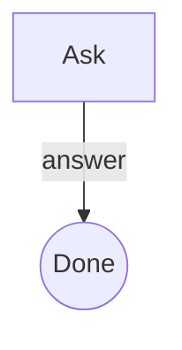

# BareMetal.MermaidDiagramRenderer

A dependency-free renderer for a deliberately small Mermaid syntax subset. It turns supported fenced `mermaid` blocks into accessible inline SVG. It creates every element with DOM/SVG APIs and writes labels through `textContent`; diagram input is never interpreted as HTML or executable code.

## Include

```html
<link rel="stylesheet" href="BareMetal.MermaidDiagramRenderer.css">
<script src="BareMetal.MermaidDiagramRenderer.js"></script>
```

After rendering Markdown, call `BareMetal.MermaidDiagramRenderer.render(container)`. The function returns the number of rendered diagrams. Unsupported Mermaid syntax remains visible as a code block.

## Supported syntax

- `flowchart` or `graph` with `TD`, `TB`, `BT`, `LR`, or `RL` direction.
- Flowchart nodes using `ID[Label]`, `ID(Label)`, `ID{Label}`, or `ID((Label))` shapes.
- One flowchart connector per line: `-->`, `---`, `==>`, `-.->`, and labeled `--|label|-->` connectors.
- `sequenceDiagram`, optional `participant ID as Label` declarations, and one message per line using `->`, `->>`, `-->`, or `-->>` with a text label.

Other Mermaid chart types and directives such as `click`, `style`, `classDef`, `subgraph`, and HTML labels are not supported. They remain as source code so content is not silently lost. Input is bounded to 12,000 characters, 100 lines, 48 flowchart nodes, 96 connectors/messages, 12 sequence participants, and 128 characters per label.

## Example

````markdown

````
